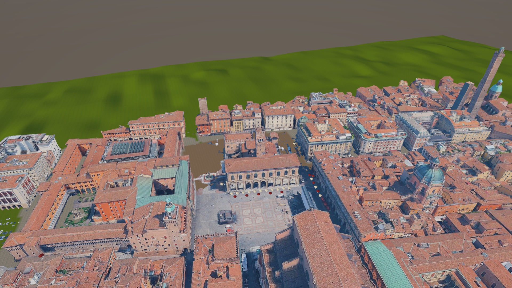
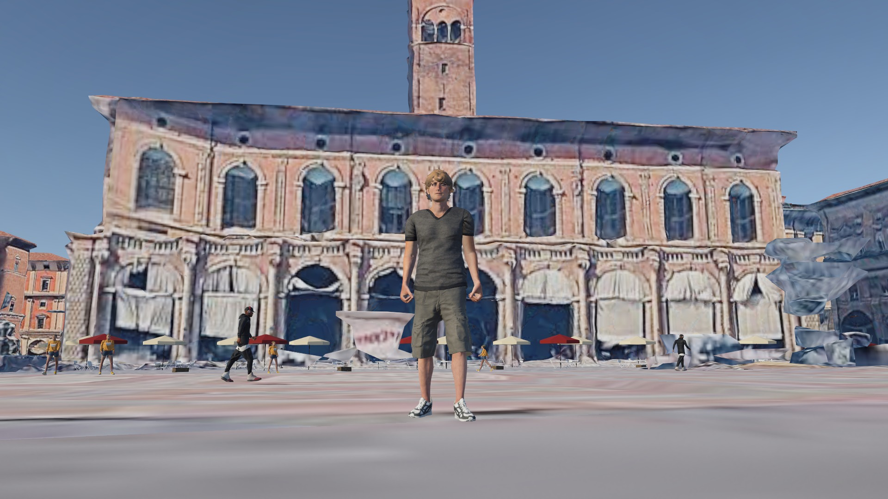
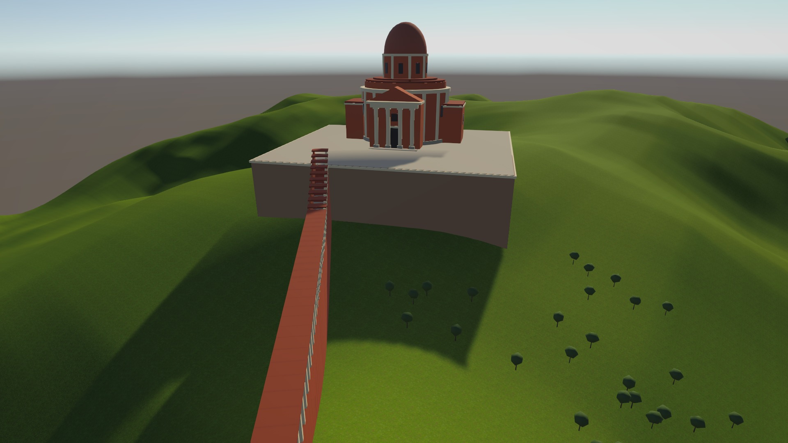

# Un Erasmus en Bolonia

Proyecto de **Computación Gráfica** (Máster, Universidad de Extremadura) hecho con **Unity 6** y **Cesium for Unity**.

Autor: **Antonio Rodríguez Iglesias** · Profesor: Pablo García Rodríguez

## La historia

Inspirada en mi Erasmus en Bolonia (2023-2024):

1. **Llegada:** Antonio llega de Erasmus y aparece en la Piazza Maggiore.
2. **La plaza:** pasea entre la gente, las terrazas y los coches.
3. **La subida:** sigue los pórticos hasta el Santuario de San Luca, en la colina.

## Qué hay en la escena

- **Ciudad real:** el centro de Bolonia con Google Photorealistic 3D Tiles a través de Cesium. El CesiumGeoreference está en el centro de Bolonia y solo se carga un trozo de la ciudad (Cesium Polygon Raster Overlay).
- **Terreno:** un Terrain de Unity con colinas y árboles pintados con Paint Trees. Hay 5 tipos de árbol, todos prefabs con LOD Group.
- **Pórticos de San Luca:** 50 tramos hechos a partir de un único prefab (`Mi_Tramo`) que suben hasta el santuario.
- **Personaje:** Remy de Mixamo (rig Humanoid) con el Third Person Controller de Starter Assets. Puede andar, correr y saltar.
- **Cámaras:** Cinemachine en tercera persona. Con la tecla **V** se cambia a primera persona.
- **Animaciones:** el Animator Controller `Jugador_Animaciones`:
  - un Blend Tree que pasa de Idle a Walk y a Run según `Speed`;
  - el salto con JumpStart, InAir y JumpLand.
- **Gente y tráfico:** 3 personajes de Mixamo paseando por la plaza (`Paseante.cs`), siempre pegados al suelo (`AjustarAlSuelo.cs`), y coches de Kenney.

## Cómo abrirlo

1. Instala **Unity 6000.3.26f1** (Unity 6.3 LTS) desde Unity Hub.
2. Clona o descarga este repositorio y ábrelo en Unity Hub con **Add → Add project from disk**.
3. Abre la escena `Assets/Scenes/Bolonia_Erasmus.unity`.
4. Pulsa **Play**. La ciudad tarda unos segundos en cargar porque viene de internet.

Si la ciudad no aparece, conecta una cuenta en la pestaña **Cesium**: menú Window → Cesium, y después **Connect to Cesium ion**.

## Controles

- **W A S D:** andar
- **Shift:** correr
- **Espacio:** saltar
- **Ratón:** mirar alrededor
- **V:** cambiar entre primera y tercera persona

## Mis scripts

Están en `Assets/_MisCosas/Scripts`:

- `Paseante.cs`: hace que una persona camine hacia delante y se dé la vuelta al llegar a cierta distancia. Usa `transform.forward` y `Time.deltaTime`.
- `AjustarAlSuelo.cs`: lanza un rayo hacia abajo cada medio segundo para que la gente no se hunda en el suelo de Cesium.
- `CambiarCamara.cs`: con la tecla V cambia la prioridad de las cámaras de Cinemachine y oculta el cuerpo en primera persona.
- `EventosPasos.cs`: recibe los eventos `OnFootstep` y `OnLand` de las animaciones de las personas, para que no salgan errores en la consola.

## Organización

- `Assets/_MisCosas`: todo lo que he hecho yo (prefabs, scripts, materiales, terreno, personajes y vehículos).
  - `Practica_porticos.unity` y `Practica_Cesium.unity` son escenas de práctica.
- `Assets/Starter Assets`: el controlador del personaje de Unity.
- `Capturas_Presentacion`: capturas de la escena y la presentación de la asignatura.

## Problemas que tuve y cómo los resolví

- **La gente salía hundida en el suelo.** Lo arreglé con el script `AjustarAlSuelo`.
- **Remy era gigante al importarlo.** Lo arreglé con la escala 0,44, y ahora mide 1,81 m.
- **Cesium tardaba mucho en cargar al pulsar Play.** Puse Maximum Screen Space Error a 16 y desactivé la recarga de dominio al entrar en Play.
- **La cámara se quedaba pegada al personaje.** Lo arreglé poniendo el Vertical Arm Length de la cámara a 0,3.

## Recursos de terceros (todos gratuitos)

- [Cesium for Unity](https://cesium.com/platform/cesium-for-unity/) y Google Photorealistic 3D Tiles (Cesium ion).
- Starter Assets – Third Person Character Controller, de Unity Technologies (Asset Store).
- Personajes y animaciones de [Mixamo](https://www.mixamo.com) (Adobe).
- [Car Kit de Kenney](https://kenney.nl/assets/car-kit) (licencia CC0).
- Bancos, farolas, jardineras y mesas de terraza de [Poly Haven](https://polyhaven.com) (licencia CC0).
- Texturas de hierba y roca de [ambientCG](https://ambientcg.com) (licencia CC0).
